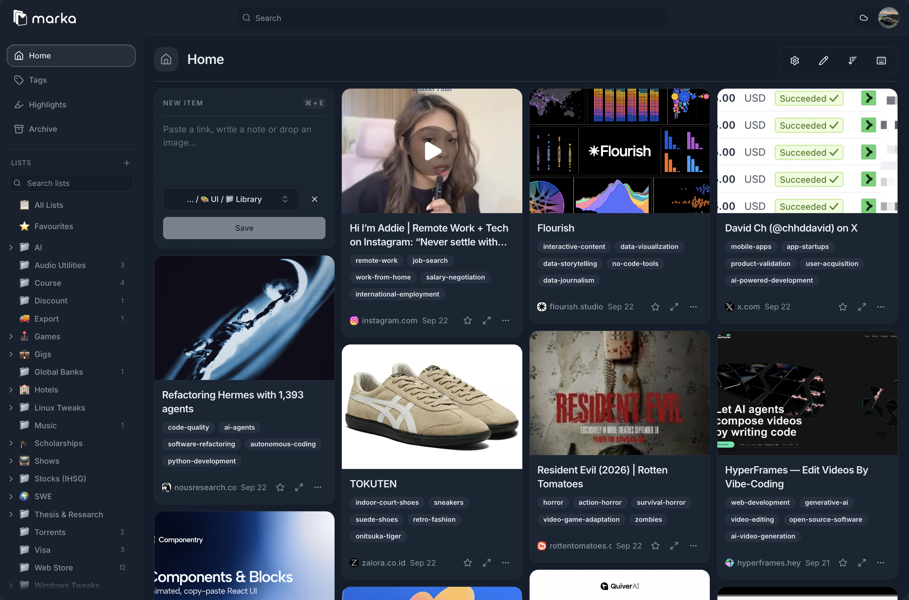
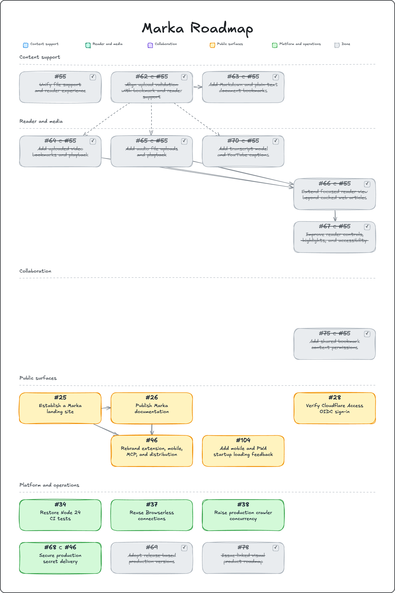

<div align="center">
  
</div>

<p align="center">
  <strong>Everything you want to come back to.</strong><br />
  A self-hosted personal library for links, watchlists, wishlists, notes, and files.
</p>

<p align="center">
  <a href="https://github.com/absolutepraya/marka/actions/workflows/ci.yml"></a>
  <a href="https://github.com/absolutepraya/marka/releases"></a>
  <a href="./LICENSE"></a>
</p>

<p align="center">
  <a href="#features">Features</a> &nbsp;·&nbsp;
  <a href="#self-host-marka">Get started</a> &nbsp;·&nbsp;
  <a href="#connect-an-ai-agent">AI agents</a> &nbsp;·&nbsp;
  <a href="#how-it-works">Architecture</a> &nbsp;·&nbsp;
  <a href="#develop-marka">Development</a> &nbsp;·&nbsp;
  <a href="#roadmap">Roadmap</a>
</p>

Save the article you want to read, the movie you want to watch, the product you are comparing, or the course material you will need again. Marka brings them into one visual library, with previews and context to help you find them later.

<p align="center">
  
</p>

## Features

| Feature | What you can do |
| --- | --- |
| **Save from anywhere** | Capture links, text, images, and PDFs through the web app, browser extension, CLI, or API. [Import existing bookmarks](docs/docs/04-using-karakeep/import.md) or subscribe to [RSS feeds](docs/docs/05-integrations/06-rss-feeds.md). |
| **Keep the context** | Retain page titles, descriptions, preview images, screenshots, and archived content alongside your own notes. |
| **Read and annotate** | Open saved articles in Reader View, highlight passages, and keep your reading progress. |
| **Organize your way** | Build nested lists, add tags, automate with rules, and share lists with collaborators. |
| **Find it again** | Search saved content with Meilisearch and narrow results with [search filters](docs/docs/04-using-karakeep/search-query-language.md). |
| **Make it your library** | Self-host your data, use the web app or PWA, and connect your own tools through the REST API, SDK, CLI, or MCP server. |

> [!TIP]
> AI tagging and summaries are optional. You can use Marka without an AI provider, or [configure one](docs/docs/03-configuration/02-different-ai-providers.md) when you want those features.

## Self-host Marka

On a **Linux `amd64` host** with **Docker Engine, Docker Compose v2, and OpenSSL** installed:

```bash
curl -fsSLo /tmp/marka-setup.sh https://raw.githubusercontent.com/absolutepraya/marka/main/scripts/install.sh && bash /tmp/marka-setup.sh
```

The guided installer asks how you will access Marka (locally, over a trusted LAN, or through an HTTPS domain) and where to store configuration and data, then sets up the web app, workers, search, and browser rendering. Use the recommended defaults or choose external services and optional AI in advanced setup.

Setup waits for web and workers to become ready. Reconfiguration keeps existing secrets and settings; the generated helper provides health diagnostics and backups before updates.

> [!IMPORTANT]
> The default listener is `127.0.0.1:3000`. For Internet access, provide a reverse proxy with TLS. The installer expects Docker to be installed and leaves DNS, firewall rules, and certificates to you.

The installer follows the paired `web-stable` and `workers-stable` image channel. For reproducible setup, replace `main` in the download URL with a reviewed release tag or commit SHA. Immutable version and source-commit image pairs are available for rollback.

**[Follow the installation guide](docs/docs/02-installation/11-guided-docker-setup.md)** for configuration choices, backups, updates, and rollback.

## Connect an AI agent

Give a compatible agent the Marka skill, install the official CLI, and connect to your instance:

```bash
npx skills add absolutepraya/marka
npm install --global @absolutepraya/marka
marka auth init
marka whoami
```

Create an API key under **Settings > API Keys** in your instance. Enter the instance address and key during `marka auth init`; the CLI stores its configuration locally with file mode `0600`. Installing the skill adds agent instructions; CLI installation and authentication connect it to your library.

See the [agent integration guide](docs/docs/05-integrations/07-agentic-skills.md) for unattended setup and REST API access, the [CLI reference](apps/cli/README.md) for commands, or the [MCP guide](docs/docs/05-integrations/03-mcp.md) for MCP clients.

## How it works

The web app and API handle your library. Background workers fetch page content and screenshots, process assets, update search indexes, and run configured AI tasks.


SQLite and asset files hold the saved library; Meilisearch provides a derived search index. Browser rendering and AI depend on the services enabled for your instance.

| Code | Responsibility |
| --- | --- |
| [`apps/web`](apps/web) | Next.js web app and API entry points |
| [`apps/workers`](apps/workers) | Crawling, screenshots, indexing, and background processing |
| [`packages/trpc`](packages/trpc), [`packages/api`](packages/api) | Application logic, tRPC routers, and REST API routes |
| [`packages/db`](packages/db), [`packages/shared-server`](packages/shared-server) | Schema, migrations, storage, and shared server infrastructure |
| [`apps/cli`](apps/cli), [`apps/mcp`](apps/mcp), [`packages/sdk`](packages/sdk) | CLI, MCP server, and TypeScript SDK |

## Develop Marka

Use **Node.js 24.18.1** from [`.nvmrc`](.nvmrc), **pnpm 11.25.0** through Corepack, Git, and a Docker-compatible runtime such as OrbStack on macOS.

Follow the [local setup guide](docs/operator-setup.md#local-development) to install dependencies, configure the root `.env` and its symlinks, and run migrations. Once configured:

```bash
pnpm dev:start
```

The launcher starts this workspace's web app and workers, ensures shared local Meilisearch and Browserless are running, and waits for web health and worker readiness. Worktrees keep separate SQLite/assets, web and worker ports, and search namespaces.

- **Parallel work:** use [`wt`](https://github.com/absolutepraya/wt) with [`.wt/config.toml`](.wt/config.toml), or import [`t3.json`](t3.json) into T3 Code. Both use the shared worktree setup scripts.
- **Validation:** see [required checks](CONTRIBUTING.md#what-to-run-before-opening-a-pr) and the [Browserless lifecycle checks](docs/operator-setup.md#validate-browser-connection-reuse-locally).
- **Operations:** see [operator setup](docs/operator-setup.md) for Linux development, explicit production-state pulls, and the personal VPS deployment workflow.
- **Documentation:** product guides live under [`docs/docs`](docs/docs); [docs-site development](docs/README.md) has its own setup.

<!-- ROADMAP:START -->
## Roadmap

<a href="./docs/roadmap/roadmap.excalidraw">
  <picture>
    <source media="(prefers-color-scheme: dark)" srcset="./docs/roadmap/roadmap-dark.png">
    <source media="(prefers-color-scheme: light)" srcset="./docs/roadmap/roadmap-light.png">
    
  </picture>
</a>

[Open the editable Excalidraw source](./docs/roadmap/roadmap.excalidraw)
<!-- ROADMAP:END -->

Marka builds on the open-source [Karakeep](https://github.com/karakeep-app/karakeep) project.
